# Floor-plan MCL + Sign Text (OCR) Observations

**건물 도면만 가진 로봇이 복도의 안내판 글자(OCR)를 함께 읽으면, 위치를 더 빨리·확실하게 찾을 수 있는가?**
— 실제 건물(단국대 1공학관 1층)의 피난안내도와 안내판 사진 22장으로 검증했습니다.

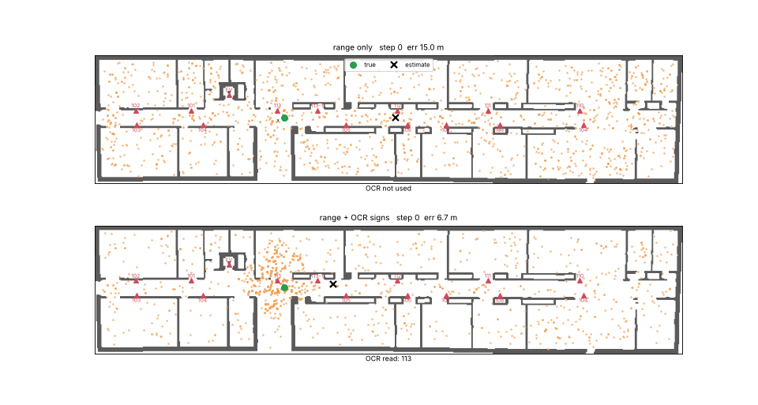
<sub>실제 도면 위 Particle filter. 위: 거리 센서만 — 비슷한 복도 여러 곳에 위치 가설이 흩어짐 / 아래: + 안내판 OCR — 105호 번호판을 읽자마자 정답 위치로 수렴. 주황 점 = 파티클(위치 가설), 초록 = 실제 위치, X = 추정 위치</sub>

### TL;DR
| | 결과 |
|---|---|
| 지도 | 피난안내도 사진 1장 → 격자 지도 자동 변환 (79 m × 17 m) |
| OCR (실제 사진 22장) | 호실 번호판 **15/15 정답, 오독 0건** (1~2 m, 45° 이내) · 화장실 픽토그램 0/3 |
| 위치추정 (실제 도면) | 위치를 찾는 데 필요한 이동 거리 **2.5 m → 1.0 m** |
| 위치추정 (180° 대칭 가상 건물) | 성공률 **60% → 95%** |
| **실제 보행 영상 (정면 카메라)** | 번호판 **0개** 인식 → 정면 카메라로는 벽면 번호판이 거의 안 보임. 측면·능동 시점이 필요 |
| 발견 | OCR 결과의 94%는 잡음(포스터·안내문) → 지도를 사전으로 쓰는 필터 필수 / 같은 글자가 여러 곳("강의실" 105·112) → 번호 우선 규칙 / 그림 기호는 OCR로 불가 → VLM 필요 |

---

## 1. 가상 대칭 건물 실험

고정밀 지도 없이 **건물 도면**만 가진 로봇이, 거리 센서와 **안내판(호실 번호) 글자**를 이용해
자기 위치를 처음부터 찾는(global localization) 문제를 먼저 '최악의 경우'인 대칭 건물에서 시뮬레이션했습니다.

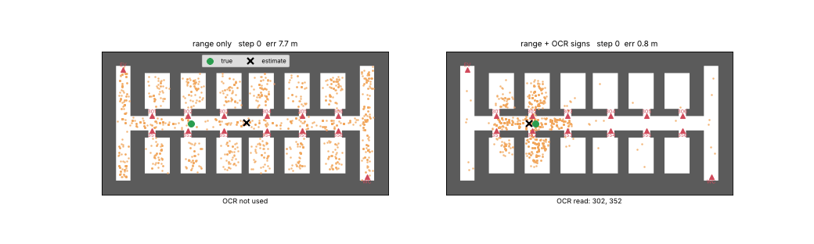
<sub>왼쪽: 거리 센서만 / 오른쪽: 거리 센서 + 안내판 OCR</sub>

### 결과 (20 seeds, 파티클 3,000개)

| method | success rate | median steps to localize* | median final error (all) | median final error (successful) |
|---|---|---|---|---|
| range only | 60% | 9 (4.5 m) | 1.00 m | 0.10 m |
| range + OCR signs | **95%** | **3 (1.5 m)** | **0.10 m** | 0.09 m |

<sub>* localized = 정답 1 m 안의 확률 질량 > 0.5. 같은 seed에서는 정답 궤적·센서 노이즈·OCR 오독이 동일하고 표지판 사용 여부만 다르다.</sub>

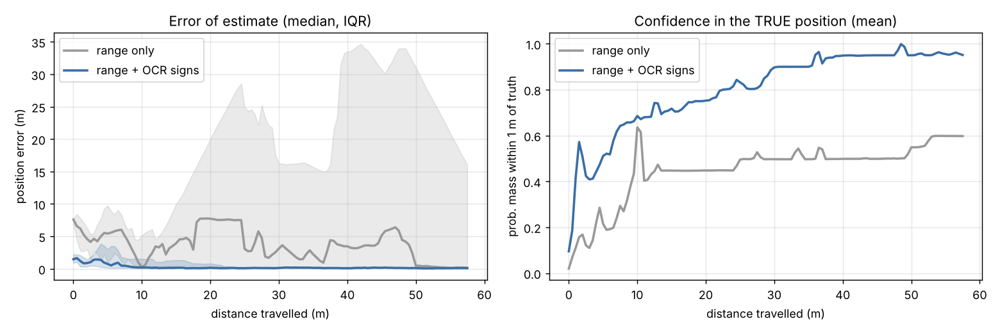

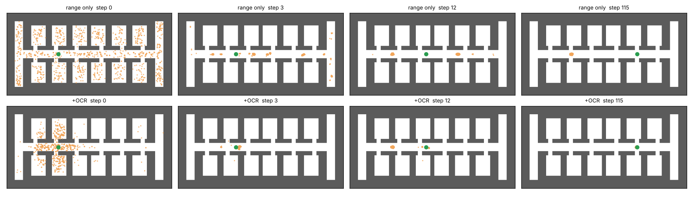

**관찰**
- 이 지도는 **180° 회전 대칭**입니다. 거리 센서와 오도메트리만으로는 실제 위치와 회전 대칭 위치를 구별할 수 없어, 필터가 반반 확률로 엉뚱한 쪽에 수렴합니다(성공률 60%, 실패 시 오차 19~25 m). 좌우·상하 *반사* 대칭은 로봇이 회전할 때 오도메트리의 회전 방향이 반대가 되어 스스로 풀리지만, 회전 대칭은 끝까지 남습니다.
- 안내판 관측을 더하면 **1.5 m 이동 만에** 위치를 찾고 95%가 성공합니다. 지도 구조(Fine)만으로는 모호하고, 텍스트·랜드마크(Coarse)가 그 모호성을 푸는 구조입니다.
- 실패 1건(seed 5): OCR은 "이 표지판이 4 m 안에 있다"는 정보만 주므로, 문이 일정 간격으로 반복되는 긴 복도에서 **2 m 정도 어긋난 가설이 오래 살아남았습니다.** → 표지판의 방향(왼쪽/오른쪽 벽)이나 글자 크기로 거리까지 추정하면 개선될 여지가 있습니다.

## 2. 실제 도면: 단국대 1공학관 1층 (피난안내도 사진 → 지도)

| 피난안내도 사진 | 자동 변환된 지도 (`floorplan_from_photo.py`) |
|---|---|
| 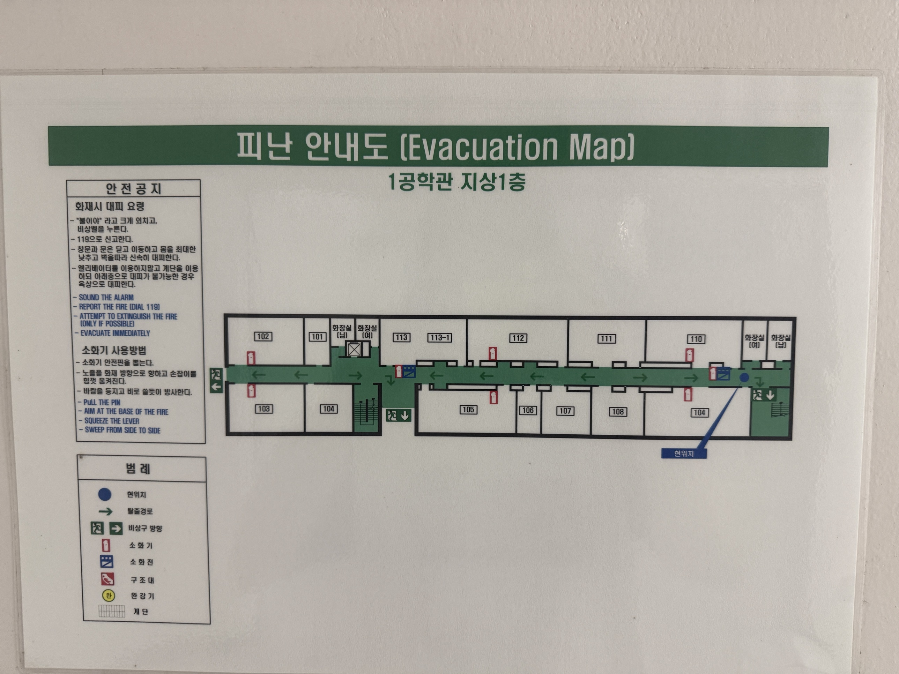 | 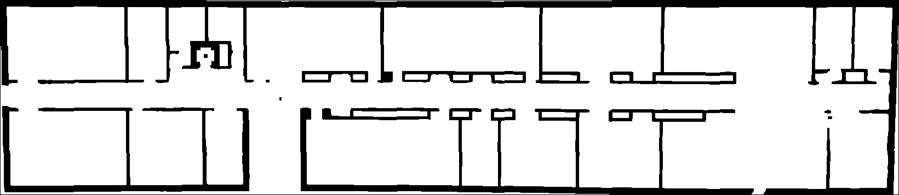 |

- 변환: 어두운 무채색 픽셀 = 벽, 초록(대피로 칠)·파랑(현위치 표시) 제외 → 작은 덩어리(방 번호 상자·글자)와 얇은 선(소화전 아이콘) 제거 → 기울기 보정(0.29°) → 건물 바깥 채우기
- 축척: 복도 끝~끝 113걸음 × 0.7 m = 79.1 m → **0.048 m/pixel**, 건물 79 m × 17 m
- 표지판 18개를 도면의 방 번호 위치(복도 쪽 벽)에 배치. **같은 글자가 두 곳**에 있음: 화장실(남)·화장실(여)가 양 끝에 하나씩, 도면상 `104`도 두 개 → 실제 환경의 perceptual aliasing

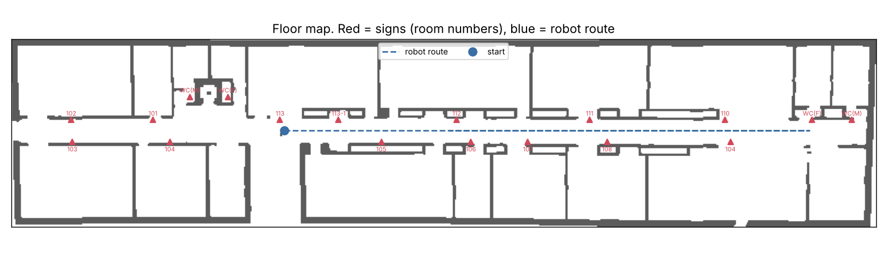

| method (10 seeds, 6,000 particles) | success rate | median distance to localize | median final error |
|---|---|---|---|
| range only | 90% | 2.5 m | 0.06 m |
| range + OCR signs | **100%** | **1.0 m** | 0.06 m |

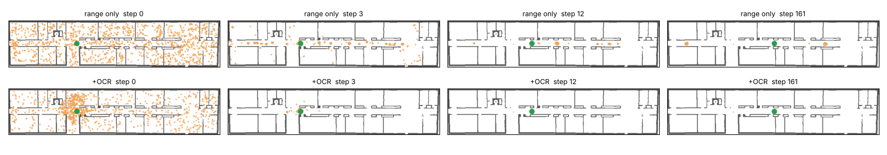
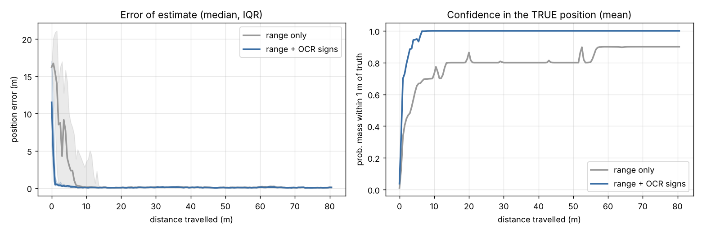

- 실제 건물은 완전 대칭이 아니라서 거리 센서만으로도 대부분 성공한다(90%). 하지만 **문 프레임이 일정 간격으로 반복되는 긴 복도** 때문에 1건(seed 7)은 끝까지 복도의 다른 지점 두 곳에 파티클이 갈라져 실패했다(위 그림 윗줄 마지막).
- 표지판을 더하면 모든 seed에서 **1 m 이동 만에** 위치를 찾는다. 양 끝 화장실처럼 같은 글자가 두 곳에 있어도, 다른 호실 번호와 함께 누적되면서 모호성이 풀린다.
- 이 실험의 OCR 성능(인식 거리 4 m, 오독 15%)은 가정값이다. 실제 안내판 사진으로 측정한 값을 넣은 결과는 아래 3장 참고.

## 3. 실제 안내판 사진 OCR 평가 (`ocr_eval.py`)

1공학관 1층 안내판 사진 22장(거리 1~3 m, 정면/비스듬히 30~45°)에 EasyOCR(한국어+영어)을 돌리고, 지도의 표지판 사전과 매칭했다.
매칭 규칙: **호실 번호 정확 일치 = 강한 증거**, 방 이름 유사 매칭(유사도 ≥0.7, 한두 글자 오독 허용) = 약한 증거. 번호를 읽으면 번호를, 못 읽으면 이름을 쓴다.

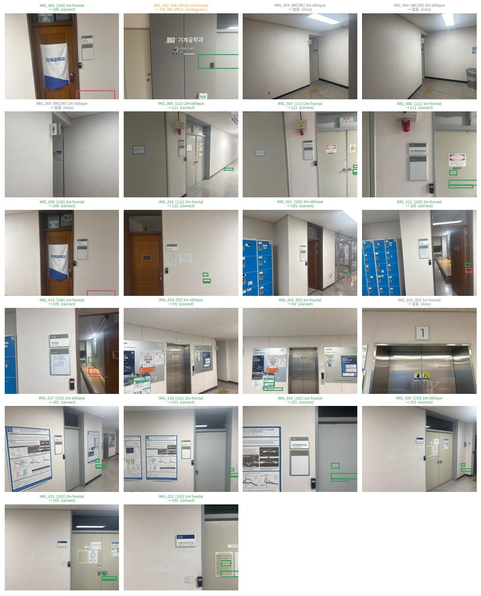

| group | photos | 정답 장소가 후보에 포함 | 유일하게 정답 |
|---|---|---|---|
| 전체 | 22 | 18 (82%) | 17 (77%) |
| 호실 번호판 (101·103·105·106·111·112) | 15 | **15 (100%)** | **15 (100%)** |
| 정면 / 비스듬히 | 14 / 8 | 93% / 62% | |
| 화장실·엘리베이터 (그림 기호, 층수) | 6 | 2 (33%) | |

- **호실 번호판은 1~2 m·45° 이내에서 모두 맞혔고, 잘못 읽은 경우(오독)는 0건.** 번호를 못 읽은 1장(111, 45° 비스듬히)도 방 이름 "에너지환경**웅**합실험실"(융→웅 오독)을 유사 매칭으로 살렸다.
- **OCR이 뽑은 글자 덩어리는 대부분 잡음**이다(포스터·안내문). 22장에서 나온 1,092개 중 지도 사전과 맞은 것은 64개(6%)뿐. 학회 포스터 앞에서 찍은 IMG_017은 덩어리가 356개였지만 지도 사전과 맞는 것은 `101` 하나뿐 → **지도를 사전으로 쓰는 필터가 필수**.
- **"강의실"은 105·112 두 곳**에 있어 이름만으로는 모호 → 번호 우선 규칙이 필요한 이유.
- **"기계공학과"는 106호 문 현수막과 학과 사무실 벽면 두 곳**에 있어 모호(IMG_002).
- **화장실 표지는 3장 모두 실패**: 사람 그림 + 세로로 쓰인 "Gentlemen" → 글자 기반 위치추정의 사각지대. 그림 기호 인식(VLM 등)이 필요.
- 엘리베이터의 "1"은 층수일 뿐 위치를 알려주지 않음. 대신 옆의 **"공과대학" 게시판**이 엘리베이터 로비의 랜드마크 역할.

**측정값을 관측 모델에 반영** (`data/signs_1F_ocr.csv`: 화장실 제외, 엘리베이터 로비 추가 / `sign_view_dist=3, p_detect=0.9, p_ocr_correct=0.95`):

| method (10 seeds) | success rate | median distance to localize |
|---|---|---|
| range only | 100% | 2.5 m |
| range + OCR signs (측정값) | 100% | **1.0 m** |


<sub>실제 도면 + 측정한 OCR 관측 모델 (seed 7). 위: 거리 센서만 — 복도의 여러 지점에 가설이 흩어져 있음 / 아래: 105호 번호판을 읽자마자 정답 위치로 수렴</sub>

<sub>거리 센서만 쓴 경우의 성공률은 노이즈 실현에 따라 90~100%로 변했다(앞 실험 90%). 일관된 효과는 **위치를 찾는 데 필요한 이동 거리가 2.5 m → 1.0 m로 줄어드는 것**. 표본 22장은 작으므로 p 값들은 참고용이다.</sub>

## 4. 실제 보행 영상 실험: 사진에서는 읽혔던 번호판이 영상에서는 0개

복도를 양방향으로 걸으며 휴대폰을 **로봇 카메라처럼 정면을 향하게** 들고 찍은 영상 2개(720p, 각 약 1분)에서
2 fps로 프레임 243장을 뽑아 OCR → 지도 매칭(`video_ocr.py`)을 돌렸다.

| | 프레임 | OCR 글자 덩어리 | 지도 표지판과 매칭 |
|---|---|---|---|
| V_002 (왼쪽 → 오른쪽, 110걸음) | 127 | 15 | **0** |
| V_001 (오른쪽 → 왼쪽, 112걸음) | 116 | 44 | **0** |

정면 사진에서는 15/15 읽혔던 호실 번호판이 **보행 영상에서는 하나도 읽히지 않았다.** 확인해 본 프레임에서는 사람 눈으로도 번호를 읽을 수 없었다.
OCR 모델의 문제가 아니라 **카메라 배치의 문제**다.

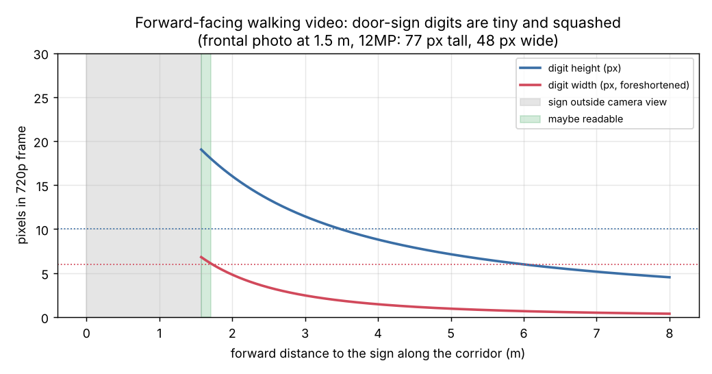

- 번호판은 복도 벽에 **복도와 평행하게** 붙어 있다. 정면을 보는 카메라에게는 멀리 있을 때는 작고 납작하게(옆에서 본 모양) 보이고, 가까워지면 시야 밖으로 빠져나간다.
- 기하학적 추정(`sign_visibility.py`, 화각 70°·720p·숫자 높이 4 cm 가정): 숫자가 읽을 만한 크기(높이 ≥10 px, 폭 ≥6 px)가 되는 구간은 **앞쪽 약 1.6~1.7 m, 걸음 속도로 0.1초 남짓**뿐이다. 같은 숫자가 정면 1.5 m 사진(12MP)에서는 약 77×48 px.
- 반대로 영상에서 읽힌 글자는 복도 쪽을 향한 **포스터·안내문**의 글자와 **"WC"** 정도였다 — 복도와 **수직으로 걸린 표지**(돌출형 화장실 표지 등)가 멀리서도 보인다.

**위치추정 재생 실험** (`video_mcl.py`): 걸음 수로 근사한 정답 궤적 위에서 거리 센서·오도메트리는 시뮬레이션하고, 표지판 관측만 바꿔 비교 (5 runs).

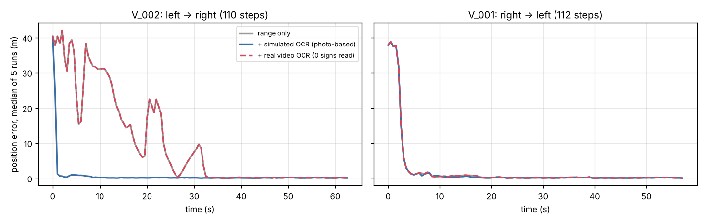

| 영상 | range only | + 사진 기반 OCR (가정) | + **실제 영상 OCR** |
|---|---|---|---|
| V_002 (왼쪽 출발) | 약 34 m 걸은 뒤 위치 확정 | **약 1 m** | range only와 동일 (관측 0) |
| V_001 (오른쪽 출발) | 약 10 m | 약 12 m | range only와 동일 (관측 0) |

- 사진으로 측정한 인식률을 그대로 가정하면 효과가 컸지만, **실제 영상에서는 효과가 사라졌다.** 단일 사진 평가만으로 관측 모델을 만들면 과대평가된다는 것이 이 실험의 결론이다.
- V_001처럼 출발 지점의 구조가 독특하면(오른쪽 끝 화장실·계단) 거리 센서만으로도 빨리 찾는다 → 표지판이 필요한 곳은 **구조가 반복되는 복도 한가운데**.

**시사점 (다음에 해볼 것)**
1. **카메라 방향**: 측면 카메라나 광각 카메라, 또는 로봇이 문 앞에서 고개를 돌려 보는 **능동 인식(active perception)**. 필터가 "곧 105호 앞"이라고 예측할 때만 멈추거나 돌아보게 하면 비용을 줄일 수 있다.
2. **표지 종류**: 멀리서 보이는 돌출형 표지(화장실·비상구)는 대부분 그림 기호 → OCR이 아니라 **VLM/아이콘 인식**이 필요 (3장의 화장실 결과와 같은 결론).
3. **해상도·프레임**: 720p·2 fps는 불리하다. 고해상도, 전체 프레임 처리, 흔들림 보정.

<sub>한계: 영상 속 정답 위치는 체크포인트 없이 걸음 수와 일정 속도로 근사했다(수 m 오차 가능). 거리 센서는 실제 LiDAR가 아니라 시뮬레이션이다. 기하 추정의 번호판 크기·화각은 근사치다.</sub>

## 구현 포인트

| 구성 | 내용 |
|---|---|
| 지도 | 도면 → 점유 격자 (0.1 m/pixel). `FloorMap.from_image()`로 실제 도면 사진 로딩 |
| 모션 모델 | 오도메트리 (이동거리, 회전) + 가우시안 노이즈 |
| 거리 센서 모델 | 12빔 레이캐스팅, 가우시안 + 무작위 측정 혼합. **likelihood tempering(0.2)**: 빔들이 독립이 아니므로 그대로 곱하면 과신 → 첫 스텝에 파티클이 몇 개로 붕괴(particle depletion) |
| 표지판 관측 모델 | "label을 읽었다 = 그 표지판이 4 m 안에 있다". OCR 오독(15%)에 대비해 최소 likelihood ε=0.05 → 한 번의 오독으로 정답 가설이 사라지지 않게 함 |
| 리샘플링 | low-variance resampling (N_eff < N/2일 때) + 매 스텝 1% 무작위 파티클 주입(복구용) |

## 실행

```bash
pip install numpy matplotlib pillow
python experiment.py --seeds 20        # 비교 실험 → results/summary.md, curves.png
python experiment.py --gif             # 비교 애니메이션 → results/mcl_compare.gif

# 실제 도면
python floorplan_from_photo.py data/evacuation_map_1F.jpg --crop 619 876 2307 1289 --steps 113
python experiment.py --plan data/plan_clean.png --signs data/signs_1F.csv \
    --route "25,8.83;73,8.83;40,8.83" --out results_1F --particles 6000 --seeds 10
python experiment.py --plan data/plan_clean.png --signs data/signs_1F.csv \
    --route "25,8.83;73,8.83;40,8.83" --out results_1F --particles 6000 --gif --gif-seed 7

# OCR 평가 + 측정값 반영
pip install easyocr
python ocr_eval.py
python experiment.py --plan data/plan_clean.png --signs data/signs_1F_ocr.csv \
    --route "25,8.83;73,8.83;40,8.83" --out results_1F_ocr --particles 6000 --seeds 10 \
    --sign-params "sign_view_dist=3,p_detect=0.9,p_ocr_correct=0.95"

# 보행 영상
python video_ocr.py data/video/V_002.mp4 --fps 2
python video_mcl.py --video V_002 --direction LR --steps 110 --seeds 5 --particles 4000
python sign_visibility.py
```

## 한계 및 다음 단계
- 합성 지도는 의도적으로 대칭으로 만든 '최악의 경우'이다. 실제 건물은 완전 대칭이 아니어서 거리 센서만으로도 성공률이 더 높을 수 있다.
- OCR 인식률은 사진 22장(호실 번호판은 1~2 m)으로만 측정했다. 시뮬레이션의 인식 거리 3 m는 이보다 약간 낙관적인 가정이다. 더 먼 거리·저조도·움직이는 로봇 카메라에서는 낮아질 것이다.
- 사진 기반으로 측정한 OCR 확률은 보행 영상에서는 성립하지 않았다(4장). 실제 시스템에서는 카메라 배치와 능동 인식이 OCR 모델보다 먼저 해결돼야 한다.
- 축척은 보폭(0.7 m) 가정에 의존한다 (±10% 오차 가능). 표지판 위치는 도면의 방 번호 위치로 근사했다.
- 카메라 이미지와 도면을 직접 매칭하는 학습 기반 Fine 위치추정(예: F3Loc)으로 거리 센서를 대체하는 것이 실제 과제와 더 가깝다.
